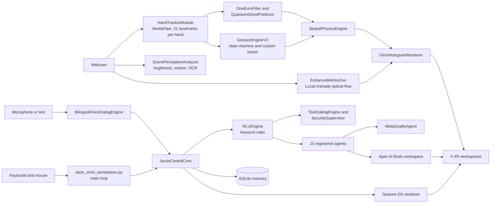

# SpatialOS v5.0 & J.A.R.V.I.S. Advanced Intelligence Core — Omni-Engine Workstation


[](https://github.com/aymnb7178/SpatialOS-JARVIS-Workstation/actions/workflows/ci_tests.yml)

> **العربية:** النسخة العربية الكاملة في [README.ar.md](README.ar.md).

A webcam-driven holographic 3D workspace built in Python with OpenCV and MediaPipe. Hand gestures grab, rotate, scale, split and pin 3D models rendered on a camera feed, while a rule-based "J.A.R.V.I.S." core handles bilingual commands, memory, tool permissions and a registry of 15 specialised agents.

This is a personal, single-developer project. The README states what is implemented and what is not; see [Current limitations](#current-limitations) and [FEATURE_MATRIX.md](FEATURE_MATRIX.md).

**Suggested GitHub "About" text:** Webcam hand-tracking holographic 3D workspace (OpenCV + MediaPipe) with a rule-based Arabic/English J.A.R.V.I.S. core, SQLite memory and a 15-agent registry.

**Suggested topics:** `spatial-computing` `computer-vision` `mediapipe` `opencv` `mixed-reality` `jarvis` `hand-tracking` `3d-graphics` `physics-engine` `python` `ar` `hologram` `multi-agent-systems`

## Contents

- [What is verified](#what-is-verified)
- [Architecture](#architecture)
- [Repository structure](#repository-structure)
- [The four XR workspaces](#the-four-xr-workspaces)
- [Hand gestures](#hand-gestures)
- [Keyboard shortcuts](#keyboard-shortcuts)
- [Technical details](#technical-details)
- [J.A.R.V.I.S. core](#jarvis-core)
- [Installation and running](#installation-and-running)
- [Tests](#tests)
- [Feature matrix](#feature-matrix)
- [Current limitations](#current-limitations)
- [Roadmap](#roadmap)
- [Author and license](#author-and-license)

## What is verified

- **16 automated tests pass** (10 for the core, 6 for the vision / physics engine), run on Python 3.13 in a headless Linux container.
- **Not exercised in that run:** live webcam tracking, on-screen rendering, microphone input, Windows-only features. They are implemented in the code but have no automated tests.
- **No performance figure is claimed.** The program *requests* 1280×720 at 60 FPS from the camera (`cv2.CAP_PROP_FPS`), but the real frame rate depends on the machine and has not been benchmarked.

## Architecture



## Repository structure

```
SpatialOS-JARVIS-Workstation/
├── jarvis_intelligence_core.py     # Core: memory, security, tools, agents, NLU
├── spatial_vision_physics_xr.py    # Vision, gestures, physics, 3D meshes, renderer
├── stark_omni_workstation.py       # Main loop, voice, Gesture OS, exporter, --test
├── tests/
│   └── test_acceptance_suite.py    # 16 tests (10 core + 6 spatial)
├── FEATURE_MATRIX.md
├── requirements.txt
├── .env.example
├── .gitignore
├── LICENSE
└── .github/workflows/ci_tests.yml
```

The three modules live in the same folder and import each other directly: `stark_omni_workstation` imports the other two, and the tests import all three.

## The four XR workspaces

Switch with **TAB**. The workspace names come from the code.

| # | Name | What it does |
|---|---|---|
| 1 | **OMEGA SANDBOX** | The main lab. Nine selectable models (`QUANTUM CORE`, `ARC REACTOR`, `HELMET ORB`, `GENOME DNA`, `HYPER CUBE`, `NET TWIN`, `GALAXY SPIRAL`, `FRACTAL PYRAMID`, `3D TUBE SCULPT`), physics fields, particles, ghost prediction, black hole / big bang / fission / fusion effects, multi-object pinning, and lightning arcs from the fingertips to the model. |
| 2 | **JAVIS CAROUSEL** | Projection pedestals with a light cone. The active model is shown large and the previous model small beside it. Change the model with **N** or the model buttons in the top bar. **P** (with no recording) toggles a black "Pepper's ghost" background. |
| 3 | **TESLA XR SIM** | A landing-approach simulation scene with a ramp, a car model (`TESLA ROADSTER`), a telemetry readout, a "K.A.R.A" status panel and a hand overlay. |
| 4 | **APEX AI BRAIN** | A network view of the agents. Pinch while hovering an agent node to run a diagnostic request for that agent. |

## Hand gestures

Recognised by `GestureEngineV2` from MediaPipe landmarks. States: `HOVER`, `SELECT`, `GRAB`, `ROTATE`, `RELEASE`, plus the two-hand states `SCALE` and `DUAL_SPLIT`.

| Gesture | State | Effect |
|---|---|---|
| Index finger only ☝️ | `SELECT` | Point at and press interface buttons and Gesture OS controls. |
| Thumb and index pinch 👌 | `GRAB` | Hold and move the model. Drag Gesture OS windows by their title bar. Run an agent in APEX AI BRAIN. |
| Closed fist ✊ | `ROTATE` | Rotate the model. In OMEGA SANDBOX it also turns the model into a **black hole** that pulls particles into a spiral. |
| Open hand right after a black hole 🖐️ | `RELEASE` | **Big bang**: shock waves and a burst of particles. |
| Open hand 🖐️ | `RELEASE` | Expands and rotates the model layers. |
| Two pinches 👌 + 👌 | `SCALE` | A green line links both hands. The distance between them scales the model (clamped between 55 and 320), its position follows the midpoint and its roll follows the angle between the hands. |
| Two open hands 🖐️ + 🖐️ | `DUAL_SPLIT` | **Dual-core fission**: the model splits into two, one above each palm, joined by a yellow beam. |
| Two open hands brought together | — | **Nuclear fusion**: the two cores merge with a shock wave. |
| Finger drawing with sculptor on (**B**) | — | Builds a 3D tube mesh along the fingertip path. |

Custom poses: press **C** while one hand is visible to store its shape as a custom pose (scale- and rotation-normalised distances between landmarks).

## Keyboard shortcuts

All 23 shortcut groups bound in the main loop.

**Navigation and view**

| Key | Action |
|---|---|
| `TAB` | Cycle the four workspaces. |
| `1` / `2` / `3` | Quality profile: `1` LOW (80 particles, no glass shader or bloom, 1 lightning branch), `2` MEDIUM (180 particles, glass shader and bloom, 3 branches), `3` HIGH (350 particles, 5 branches). |
| `G` | Show or hide the Gesture OS windows (telemetry, "15 MULTI-AGENT STATUS & QA", "APPROVED TOOLS & SECURITY GATE"). |
| `D` | Dark / light theme in the Gesture OS windows. |
| `R` | Reset the active object to the screen centre at its default scale. |
| `Q` / `ESC` | Quit. |

**Objects and physics**

| Key | Action |
|---|---|
| `F` or `SPACE` | Pin the current object in space. Press again on a pinned object to remove the pin. |
| `L` | Lock or unlock the active pinned object. |
| `U` | Remove all pins. |
| `N` | Next 3D model. If a security prompt is pending, deny it instead. |
| `M` | Cycle physics fields: `HAND_ATTRACTOR (F=300/d)`, `MAGNETIC_DIPOLE`, `HARMONIC_WAVE`. |
| `B` | Toggle the 3D tube air sculptor (switches to OMEGA SANDBOX and the `3D TUBE SCULPT` model). |
| `Z` | Undo the last object state. |
| `Y` | Confirm the pending security prompt. If none is pending, redo. |

**Recording and vision**

| Key | Action |
|---|---|
| `V` | Start or stop the motion recorder (up to 600 frames). |
| `P` | Play or stop the recording. If there is no recording, toggle the "Pepper's ghost" black background. |
| `A` | Toggle the AR optical-flow anchor (only when a camera is available). |
| `C` | Learn the current hand shape as a custom pose (needs a visible hand). |
| `O` | Run OCR on the current camera frame. |

**J.A.R.V.I.S. and voice**

| Key | Action |
|---|---|
| `T` | Run a fixed Arabic test request through the core (code, data, engineering and security checks). |
| `H` | Listen for one voice command (Arabic `ar-SA`, then English `en-US`). Needs the optional voice packages. |
| `I` | Interrupt speech and cancel the running task. |
| `E` | Export the project files and a feature table to `./SpatialOS_JARVIS_Repo/`. |

## Technical details

**Hand tracking.** MediaPipe Hand Landmarker, up to 2 hands, 21 landmarks each. The camera is requested at 1280×720. Distance is a heuristic, not a calibrated measurement: `est_distance_cm = clamp(4800 / hand_size, 18, 120)`.

**1-Euro filter.** Adaptive smoothing of tracked coordinates:

$$\tau = \frac{1}{2\pi f_c}, \qquad \alpha = \frac{1}{1 + \frac{\tau}{\Delta t}}, \qquad f_c = f_{c\min} + \beta\,|\dot{x}|$$

**Ghost prediction.** Keeps the last up to 20 frames of position and rotation and extrapolates 150 ms ahead from the average velocity (linear extrapolation). It draws a ghost model only when at least 5 samples exist and the speed is above 35 px/s.

**AR anchor.** Features are found with `goodFeaturesToTrack` (up to 45 corners), tracked with Lucas-Kanade optical flow, and the camera motion is estimated with `estimateAffinePartial2D`.

**Scene analysis and OCR.** Brightness percentage and motion bounding boxes from frame differencing. OCR uses `pytesseract` if installed; otherwise a Canny edge-density check reports whether text-like regions are present.

**Physics.** The hand attractor applies a force that falls off with distance:

$$F = \frac{300 \times 35}{d + 1}$$

Other fields are a magnetic dipole and a harmonic wave. Black hole, big bang, fission and fusion are particle and shock-wave effects.

**Rendering.** Meshes are drawn with OpenCV. Each face is shaded by the angle between its normal and the light direction:

$$\text{brightness} = \max\left(0.2,\ \left|\vec{n}\cdot\vec{L}\right|\right)$$

Fingertips push nearby vertices away, and a bloom pass adds glow on the HIGH and MEDIUM profiles.

**Motion recorder.** Records up to 600 scene snapshots and plays them back at 1.0x. There is an undo / redo stack for object states.

## J.A.R.V.I.S. core

**Intent parsing.** `NLUEngine` detects Arabic or English and maps keywords to sub-tasks, agents and tools. It handles compound requests by collecting every matching keyword group. It is a rule-based parser, not a language model.

**Memory.** Five layers in `JarvisMemoryEngine`:

| Layer | Storage | Content |
|---|---|---|
| Working | RAM | Current goal, steps, last 25 conversation turns. |
| Episodic | SQLite | Session summaries and decisions. |
| Semantic | SQLite | Facts with a confidence value and source, marked confirmed or assumption. |
| Project | SQLite | Per-project description, architecture, known issues, last stable state. |
| Preference | SQLite | User preferences and routing corrections. |

Text that looks like a secret (`password`, `token`, `sk-...`, `AIza...`) is refused by the memory layer, and a logging filter redacts such patterns from log lines. The database file `jarvis_core_memory.db` is created in the working directory and is git-ignored.

**Security and tools.** Only registered tools can run. Tool tiers: `LOW` runs immediately; `MEDIUM` and `HIGH` return a confirmation token and wait for **Y** (or an explicit confirmation call). A 3-second idempotency guard blocks duplicate sensitive calls. A scanner rejects requests that match five known injection patterns. File integrity uses SHA-256. The approved-app launcher only starts `calc.exe`, `notepad.exe` or a Command Prompt, and only on Windows. The only `HIGH` tool in the code is a stub that deletes nothing.

**Model gateway.** `UnifiedModelGateway` can call the OpenAI chat completions endpoint when `OPENAI_API_KEY` is set and otherwise returns a fixed local placeholder. The core creates it, but nothing in the current pipeline calls it. `GEMINI_API_KEY` is only detected; there is no Gemini integration in this code.

**Agents.** The core registers 15 agents plus a separate `MetaQualityAgent` that checks the plan, scans outputs for injection patterns and flags failed agents. Four agents have their own logic. The other eleven are registry entries with a role description; their handler returns an acknowledgement message.

| # | Agent | Role | Implementation |
|---|---|---|---|
| 1 | AI Research Agent | Source verification and research synthesis | Registry entry |
| 2 | Coding Agent | AST scan of workspace `.py` files: classes, functions, imports | **Custom logic** |
| 3 | Data Analysis Agent | Mean, median, standard deviation, 2-sigma outliers | **Custom logic** |
| 4 | Computer Vision Agent | Camera stream, hand tracking, scene perception | Registry entry |
| 5 | Cybersecurity Agent | SHA-256 integrity and audit logs | Registry entry |
| 6 | Robotics Agent | Simulated kinematics, velocity clamp, independent E-stop | **Custom logic** (simulation only) |
| 7 | Engineering Agent | Volume, mass estimate (35 % fill factor), BOM template | **Custom logic** |
| 8 | XR Agent | Meshes, shaders, pinning, AR anchors | Registry entry |
| 9 | Automation Agent | Approved OS actions and telemetry | Registry entry |
| 10 | Voice Agent | Speech recognition and synthesis | Registry entry |
| 11 | Memory Agent | Semantic and project memory indexing | Registry entry |
| 12 | Security Supervisor | Access control and the risk gate | Registry entry |
| 13 | Testing Agent | Automated verification | Registry entry |
| 14 | Documentation Agent | Architecture docs and feature matrix | Registry entry |
| 15 | Planning Agent | Task decomposition and scheduling | Registry entry |

## Installation and running

**Requirements:** Python 3.9 or newer, a webcam (a mouse fallback exists in the code for machines without one, but it has not been exercised), and an internet connection on first run to download MediaPipe's `hand_landmarker.task` model.

```bash
git clone https://github.com/aymnb7178/SpatialOS-JARVIS-Workstation.git
cd SpatialOS-JARVIS-Workstation
python -m venv .venv
source .venv/bin/activate          # Windows: .venv\Scripts\activate
pip install -r requirements.txt
python stark_omni_workstation.py
```

**Optional packages** (see `requirements.txt`): `SpeechRecognition` with `PyAudio` for voice input, and `pytesseract` with the Tesseract binary for full OCR. Spoken replies and the app launcher use Windows features.

**Optional API key.** The code reads real environment variables and does not load a `.env` file by itself. Copy `.env.example` for reference and export the values:

```bash
export OPENAI_API_KEY="your-key"           # Windows PowerShell: $env:OPENAI_API_KEY = "your-key"
```

Never commit real keys. `.env` is git-ignored.

## Tests

```bash
python stark_omni_workstation.py --test
# or
python -m unittest tests.test_acceptance_suite -v
```

The suite has 16 tests: `JarvisAcceptanceTestSuite` (10) and `SpatialVisionPhysicsTestSuite` (6). They need `opencv-python`, `mediapipe` and `numpy`, but no camera or display. The GitHub Actions workflow in `.github/workflows/ci_tests.yml` runs the same command on every push and pull request.

## Feature matrix

Full table with test names and notes: [FEATURE_MATRIX.md](FEATURE_MATRIX.md).

| Status | Meaning | Examples |
|---|---|---|
| ✅ Implemented and tested | Covered by an automated test | Memory, tool gate, injection scanner, 1-Euro filter, ghost predictor, pinning, physics, 9 meshes, tube sculptor |
| 🟡 Implemented, not auto-tested | Needs camera, display or microphone | Live hand tracking, gestures, AR anchor, renderer, four workspaces |
| 🟠 Partial or optional | Depends on an optional component | OCR, voice input, spoken replies, app launcher, 11 of the 15 agents, model gateway |
| ⛔ Not implemented | — | ROS2 / 3D-printer bus, Gemini integration |

## Current limitations

- Intent parsing is keyword-based. It will miss phrasing that does not contain the expected words.
- Eleven of the fifteen agents only acknowledge a task. The "autonomous" request path runs keyword-selected tools and agents; it is not a self-directed multi-agent system.
- The model gateway is not connected to the pipeline, and the local fallback is a placeholder.
- The `HIGH`-tier tool is a stub. Robotics runs in simulation only.
- Distance in centimetres is an uncalibrated estimate.
- Playback speed of the motion recorder is fixed at 1.0x.
- Spoken replies and app launching are Windows-only. RAM metrics are not available on macOS.
- Voice recognition uses an online recogniser and needs internet.
- No frame-rate benchmark exists.
- The built-in `[E]` exporter writes its own, more optimistic feature table; treat `FEATURE_MATRIX.md` as the reference.

## Roadmap

- Wire `UnifiedModelGateway` into the request pipeline and add tests.
- Give the remaining agents real handlers or reduce the registry to the agents that work.
- Add a calibration step for distance estimation.
- Add tests for gesture classification using recorded landmark data.
- Add screenshots and a short demo GIF.

## Author and license

**Aymen Abdurabu Al Erwi** — [github.com/aymnb7178](https://github.com/aymnb7178)

Released under the [MIT License](LICENSE).
